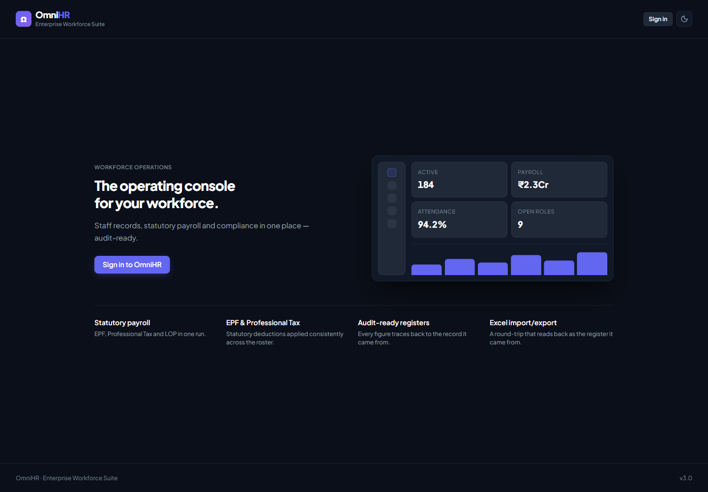
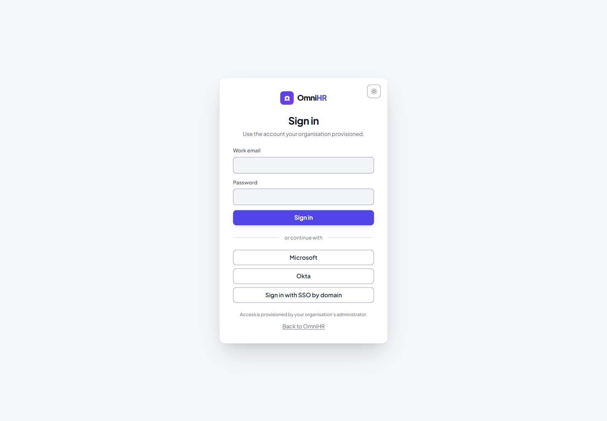
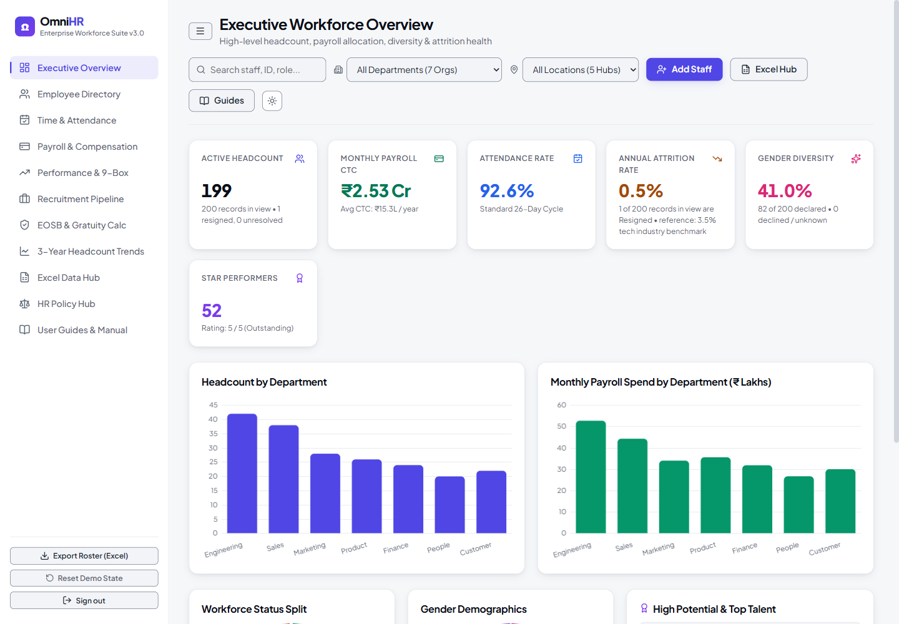

# OmniHR — Enterprise Workforce & HR Intelligence Suite (v1.2.1)

OmniHR is a modern, general-purpose enterprise HR management and dashboard visualization application built with **React 19, TypeScript, Vite 8, Chart.js 4, and SheetJS (XLSX)**.

Adapted and generalized from multi-location workforce data, OmniHR supports complete corporate human resources operations: from executive C-suite workforce analytics to employee master directories, biometric time & attendance, statutory payroll structures, 9-box performance matrices, recruitment funnels, bi-directional Excel synchronization, and comprehensive operational documentation.

[](https://github.com/Utharam/HR-Dashboard)

## Quick start

```bash
git clone https://github.com/Utharam/HR-Dashboard.git
cd HR-Dashboard
npm install
npm run dev
```

Open the Vite URL printed in the terminal (usually `http://localhost:5173`).

## Demo access

This is a front-end demo. Authentication is a local stub: there is no backend, no real user store, and no data leaves the browser.

| Field | Value |
|---|---|
| Work email | `ceo@acme.com` |
| Password | `demo` |

Sessions are stored locally and expire after 8 hours. Any non-empty email/password is accepted by the stub. The **Microsoft**, **Okta** and **SSO by domain** buttons are demonstrable stubs as well.

All business data stays in this browser (IndexedDB, with a `localStorage` fallback). Nothing is uploaded; the only file that leaves the browser is the JSON snapshot you export yourself.

## Screenshots

| Landing | Sign in | Console |
|---|---|---|
|  |  |  |

---

## 📚 Included Operational & Technical Guides

OmniHR includes two comprehensive operational guides accessible both **in-app via the "User Guides & Manual" tab** and as standalone documentation files in the repository:

1. **[General Application Guide](docs/GENERAL_APP_GUIDE.md)**:
   - Complete architectural overview and local-first data privacy model.
   - Deep dive into all 12 functional HR modules (Directory, Attendance, Leave Planner, Payroll, Performance, Hiring, Gratuity, Trends, Admin & Data Exchange).
   - Strict Indian statutory compliance formulations: EPF (Employees' Provident Fund Act 1952) ₹15,000 wage ceiling calculation, Payment of Gratuity Act 1972 (15/26 formula, 6-month rounding rule, ₹20 Lakhs statutory cap), Industrial Disputes Act Section 25F retrenchment compensation, and 26-day working month Loss of Pay (LOP) calculations.
   - Step-by-step administrative workflows (Adding staff, viewing & printing payslips, calculating final separation settlements).

2. **[Excel Sheet Handling Guide](docs/EXCEL_SHEET_HANDLING_GUIDE.md)**:
   - Supported spreadsheet formats: `.xlsx`, `.xls`, `.csv` with automatic first-sheet detection.
   - Master Column Mapping Matrix: Recognized column headers and aliases for Workday, SAP SuccessFactors, BambooHR, Darwinbox, Zoho People, and custom spreadsheets.
   - Technical date parsing: Excel numerical serial codes (e.g. `44927`), ISO dates (`YYYY-MM-DD`), and regional date strings (`DD/MM/YYYY`).
   - Automated component derivation: Converting single CTC columns into Basic (50%), HRA (25%), Special Allowance (25%), and statutory EPF.
   - Pre-sync inspection preview with recognized column badge matrix and data sanitization warnings.
   - Export specifications for Staff Master Rosters and Bank-Ready Monthly Payroll Registers.

---

## Architecture & Upgraded Tech Stack

- **Frontend Framework:** React 19 + TypeScript (Strict Type Safety)
- **Bundler & Build Tool:** Vite 8 (Ultra-fast HMR and sub-second production builds)
- **Visualizations:** Chart.js 4 + `react-chartjs-2` (Bar charts, line trends, doughnut distributions)
- **Icons:** Lucide React
- **Spreadsheet Engine:** SheetJS (`xlsx`) for drag-and-drop parsing, flexible column alias mapping, and formatted exports
- **Persistence:** Local-first architecture — business data (employees, policies, leave plans, planner settings) is stored in **IndexedDB**, with a `localStorage` fallback and a visible warning where IndexedDB is unavailable. Theme and session stay in `localStorage`. Full offline capability.
- **Backup & handoff:** a versioned JSON snapshot of every business dataset can be exported from the Admin page and re-imported on another machine.

---

## Core System Modules

1. **Executive Workforce Overview:**
   - C-suite KPI cards: Total Headcount, Monthly Gross Payroll, Average Annual CTC, Attendance Rate %, Annualized Attrition %, and Diversity Ratio.
   - Real-time interactive charts: Department Headcount, Payroll Expenditure by Org, Employment Status split, and Gender Demographics.
   - High-potential talent showcase.

2. **Employee Master Directory (200 Profiles):**
   - 200 corporate staff across 7 functional departments (Engineering, Sales, Marketing, Product & UX, Finance, People & HR, Customer Success).
   - Multi-location filtering (Bengaluru HQ, Mumbai Hub, Delhi-NCR, Hyderabad, Remote).
   - Fast table pagination (25 records per page) with role, department, and text search.
   - Profile drawer with personal details, reporting line, and statutory ID records.

3. **Time, Attendance & Leave Quotas:**
   - Standard 26-day corporate working cycle (excluding Sundays/weekly offs).
   - Leave quotas tracking: Casual Leave (CL), Sick Leave (SL), Privilege/Earned Leave (EL), and Loss of Pay (LOP) days.
   - Automatic Loss of Pay (LOP) wage deductions: `(Basic / 26) * LOP Days`.

4. **Leave Planner & Coverage Calendar:**
   - HR records future leave per employee: type (CL, SL, EL, LOP, Maternity, Paternity, Comp Off, Other), status (Planned, Approved, Cancelled) and an AM/PM half-day on single-day entries.
   - Monday-first month calendar with prev/today/next navigation: each day shows a count badge, up to three employee initials and a `+N` overflow; Sundays are muted; clicking a day opens its entries for editing or deletion.
   - Filters for department, location, employee search, leave type and status.
   - Summary tiles: people on leave today, peak day this month, upcoming leave in the next 30 days, and working days booked this month.
   - Configurable coverage threshold (`maxConcurrentLeave`, default 3): days at or above it are highlighted in the calendar and listed under Peak days. Durations count working days (Sundays excluded).

5. **Payroll & Compensation Engine:**
   - Standard Indian CTC breakdown: 50% Basic Salary, 25% House Rent Allowance (HRA), 25% Special Allowance.
   - Statutory Deductions:
     - **EPF:** 12% on eligible basic capped at statutory ₹15,000 wage ceiling (= ₹1,800/mo).
     - **Professional Tax (PT):** State statutory deduction (₹200/mo).
   - Disbursable Net Take-Home Salary.
   - One-click printable **Verified Executive Payslip**.

6. **Performance & 9-Box Talent Matrix:**
   - 9-Box talent matrix categorization: Future Leaders/Stars, High Performers, Core Backbone, and Performance Improvement (PIP).
   - Bell curve appraisal distribution (1 to 5 star ratings).

7. **Talent Acquisition & Recruitment Pipeline:**
   - Open corporate requisitions tracker across departments.
   - Candidate funnel stages: Sourcing, Screening, Interviewing, Offer Extended, and Hired.
   - Average Time-to-Hire and applicant volume metrics.

8. **Statutory EOSB & Gratuity Calculator:**
   - Exact compliance with the **Payment of Gratuity Act 1972**:
     - Service fractions $\ge 6$ months (0.5 years) round up to the next full completed year.
     - Statutory ceiling cap of **₹20,00,000 (20 Lakhs)** under the 2018 amendment.
     - Minimum 5 years continuous service eligibility.
   - Differentiates **Voluntary Resignation** (Gratuity + Leave Encashment) vs. **Involuntary Retrenchment / Layoff** (Gratuity + Leave Encashment + 1-Month Notice in lieu + Retrenchment Compensation under Section 25F of the Industrial Disputes Act).

9. **33-Month Financial & Headcount Analytics (Jan 2024 – Sep 2026):**
   - 3-year historical trend line chart comparing Consolidated Payroll Spend (₹ Crores) with Headcount Growth.
   - Historical monthly turnover, hiring, and exit ledger.

10. **Excel Data Hub (inside Admin):**
   - **Spreadsheet Ingestion:** Drag-and-drop any Excel spreadsheet (`.xlsx`, `.xls`, `.csv`). Auto-detects columns whether from Workday, SAP, BambooHR, Darwinbox, or custom spreadsheets.
   - **Download Standard Template:** Generates a pre-formatted Excel template with recognized column headers.
   - **Export Master Roster:** Downloads the complete 200 employee directory as an Excel file with all 24 columns, including the canonical department ID, the reporting line, PF UANs and leave balances. The file round-trips: importing it reproduces the register it came from.
   - **Export Payroll Register:** Generates a bank-ready payroll register spreadsheet with line-by-line deduction breakdowns.

11. **Admin & Data Exchange:**
    - **Data snapshot card:** record counts, the active storage backend (IndexedDB or the localStorage fallback), whether the pre-migration legacy `localStorage` backup exists, and the last exported/imported timestamps for this browser.
    - **Export snapshot:** one versioned JSON file (`omnihr-snapshot-YYYY-MM-DD.json`) containing every business dataset — employees, policies, leave plans and planner settings. Save it to Google Drive, OneDrive or any shared drive; the snapshot is the backup.
    - **Import snapshot:** the file is validated (format version and row schema) and confirmed with record counts before it replaces all business data; a malformed or wrong-version file changes nothing. An imported snapshot is a local copy of this browser — changes made from it do not propagate back to HR.
    - The Excel Data Hub and its guide link are unchanged inside this page.

12. **HR Policy & Benefits Hub:**
    - **Maternal Provisions:** 182-day (26-week) paid maternity leave complying with Maternity Benefit Act 2017, pre/post-natal splits, nursing breaks, creche allowance, and full list of corporate newborn welcome gift hampers.
    - **Paternal Provisions:** 15-day paid paternity leave, flexible 180-day availing window, and celebratory new father care kits.
    - **Leave Quotas & Rules:** Casual Leave (12d), Sick Leave (12d with medical proof threshold), Privilege/Earned Leave (15d with encashment), Bereavement Leave (5d), and Marriage Leave (5d with luxury retreats).
    - **Separation & Notice Periods:** 30-day (probation), 60-day (confirmed), and 90-day (leadership) notice rules, notice buyout calculations, and Garden Leave provisions.
    - **Sabbaticals & Career Breaks:** Extended career break from 90 to 365 days with role re-entry guarantees and retained stock options.
    - **Custom Rules Engine:** Full interactive creator to define custom policies with custom days, compensation type, selectable gifts/perks, eligibility, and rule clauses, persisted through the app's data store.

13. **In-App User Guides & Manual:**
    - Interactive knowledge base featuring searchable topics, click-to-copy column headers, statutory formulation tables, and step-by-step ingestion walkthroughs.

---

## Data storage & backups

- **IndexedDB is the primary store** for business data: employees, policies, leave plans and planner settings. Theme and session stay in `localStorage` (the pre-paint theme switch must be synchronous).
- **One-time migration:** on the first load, existing data under the legacy `omnihr_employees` / `omnihr_policies` `localStorage` keys is copied into IndexedDB in a single transaction. The legacy keys are kept untouched as a read-only backup, and the Admin page reports that they exist.
- **Fallback:** if IndexedDB is unavailable (private mode or a blocked database), the app saves to `localStorage` instead and shows a warning banner above the console, so the session keeps working with a smaller storage limit.
- **Snapshots are the backup:** export the full JSON snapshot from **Admin** and save it to Google Drive, OneDrive or any shared drive. Importing a snapshot replaces all business data in that browser after a validated confirmation.

---

## Getting Started

### Prerequisites
Node.js **20.19+** or **22.12+** installed (the Vite 8 requirement).

### Development Mode
```bash
git clone https://github.com/Utharam/HR-Dashboard.git
cd HR-Dashboard
npm install
npm run dev
```
Open your browser at the local Vite URL printed in the terminal (usually `http://localhost:5173`).

### Production Build
```bash
npm run build
```
This produces a compiled, optimized static distribution in the `dist/` directory.

### Code Quality & Static Analysis
```bash
npm run lint
```

### Tests
```bash
npm run test
```
Runs the Vitest 5 suite: unit tests in Node and DOM tests in jsdom.

### Deploying
- **Netlify / Vercel:** build command `npm run build`, publish directory `dist`.
- **GitHub Pages:** for a project site (`https://<user>.github.io/HR-Dashboard/`), set `base: '/HR-Dashboard/'` in `vite.config.ts`, then publish `dist`.

---

## Feedback & issues

This is a public repository. Please open an issue at https://github.com/Utharam/HR-Dashboard/issues for bugs, questions or suggestions.
