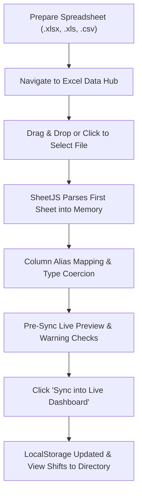

# OmniHR — Excel Sheet Handling & Spreadsheet Synchronization Guide
# Technical & Operational Reference Manual (v1.1.0)

This guide provides complete technical documentation and best practices for importing, mapping, validating, and exporting spreadsheets in the **OmniHR Enterprise Workforce Suite**.

Whether you are migrating from an enterprise HRMS (Workday, SAP SuccessFactors, BambooHR, Darwinbox, Zoho People) or maintaining custom payroll workbooks, OmniHR's **SheetJS** ingestion engine provides flexible, error-resilient column mapping and instant synchronization.

---

## Table of Contents

1. [Overview & Supported Formats](#1-overview--supported-formats)
2. [Master Column Mapping Reference Matrix](#2-master-column-mapping-reference-matrix)
3. [Salary & Statutory Component Derivation](#3-salary--statutory-component-derivation)
4. [Date Parsing & Technical Normalization](#4-date-parsing--technical-normalization)
5. [Attendance & Leave Calculation Rules](#5-attendance--leave-calculation-rules)
6. [Step-by-Step Spreadsheet Ingestion Workflow](#6-step-by-step-spreadsheet-ingestion-workflow)
7. [Export Formats & Bank-Ready Registers](#7-export-formats--bank-ready-registers)
8. [Data Validation, Edge Cases & Sanitization](#8-data-validation-edge-cases--sanitization)
9. [Third-Party HRMS Compatibility Profiles](#9-third-party-hrms-compatibility-profiles)
10. [Troubleshooting & Common Ingestion Errors](#10-troubleshooting--common-ingestion-errors)

---

## 1. Overview & Supported Formats

OmniHR provides bi-directional spreadsheet compatibility powered by **SheetJS (`xlsx`)**:

- **Supported File Extensions:**
  - `.xlsx` — Microsoft Excel OpenXML Spreadsheet (2007+)
  - `.xls` — Microsoft Excel 97-2004 Binary Format
  - `.csv` — Comma Separated Values
- **Sheet Detection:**
  - OmniHR automatically selects and parses the **first sheet** (`wb.SheetNames[0]`) in the uploaded workbook.
  - Cell formatting and dates are parsed with `{ cellDates: true }`.
- **Client-Side Privacy:**
  - The spreadsheet buffer is processed entirely in the user's browser memory (`ArrayBuffer`).
  - No spreadsheet files or employee salaries are ever transmitted across the network.

---

## 2. Master Column Mapping Reference Matrix

OmniHR uses a **flexible column alias engine** that dynamically matches spreadsheet headers regardless of naming variations, capitalization, or extra spacing.

| Target OmniHR Field | Accepted Column Headers / Aliases in Excel | Data Type | Default Fallback Value | Notes & Rules |
| :--- | :--- | :--- | :--- | :--- |
| **Employee ID** | `Employee ID`, `Emp ID`, `EmployeeID`, `id`, `ID`, `Staff ID` | String | `EMP-1201 + row_index` | Unique identifier. Whitespace trimmed. |
| **Full Name** | `Full Name`, `Employee Name`, `Name`, `name`, `Employee`, `Staff Name` | String | `Staff Member {row}` | Used across directory and payslip headers. |
| **Department** | `Department`, `department`, `Dept`, `Dept Name`, `Division` | String | `Engineering & Technology` | Used for departmental grouping and charts. |
| **Designation / Role** | `Designation / Role`, `Designation`, `Role`, `role`, `Title`, `Job Title`, `Position` | String | `Software Engineer` | Job title displayed on profile cards. |
| **Office Location** | `Office Location`, `Location`, `location`, `Branch`, `City`, `Office` | String | `Bengaluru HQ` | Regional hub (Bengaluru, Mumbai, Delhi, etc.). |
| **Date of Joining** | `DOJ`, `Date of Joining`, `Joining Date`, `Hire Date`, `doj` | Date / String / Serial | `2023-01-15` | Normalized to `YYYY-MM-DD`. Supports Excel serial numbers. |
| **Monthly CTC** | `Monthly CTC`, `MonthlyCTC`, `Monthly Gross CTC`, `CTC`, `salary`, `Gross Salary` | Number | Derived from Annual CTC or `120000` | Fixed gross monthly cost-to-company in INR. |
| **Annual CTC** | `Annual CTC (INR)`, `Annual CTC`, `AnnualCTC`, `Yearly CTC`, `package` | Number | `Monthly CTC * 12` | If Monthly CTC is omitted, `Annual CTC / 12` is used. |
| **Basic Salary** | `Monthly Basic Salary`, `Basic Salary`, `BasicSalary`, `Basic`, `basic` | Number | `Monthly CTC * 0.50` | 50% of CTC under standard wage norms. |
| **HRA** | `HRA`, `House Rent Allowance`, `hra` | Number | `Basic Salary * 0.50` | Standard 25% of CTC (50% of Basic). |
| **Special Allowance** | `Special Allowance`, `SpecialAllowance`, `specialAllowance` | Number | `Monthly CTC - (Basic + HRA)` | Balancing executive allowance. |
| **Employment Status** | `Status`, `status`, `Employment Status` | String | `Active` | Normalized to: `Active`, `Probation`, `Notice Period`, `Resigned`. |
| **Gender** | `Gender`, `gender`, `Sex` | String | `Female` | Normalized to: `Female`, `Male`, `Non-Binary`. |
| **Performance Rating** | `Performance Rating`, `Rating`, `performanceRating`, `Score` | Number (1–5) | `4` (Exceeds Expectations) | Clamped to integer between 1 and 5. |
| **Attendance Days** | `Attendance (Days Present)`, `Attendance Days`, `PresentDays`, `presentDays`, `Attendance` | Number (0–26) | `25` | Days present in standard 26-day business cycle. |
| **Casual Leave (CL)** | `CL Balance`, `Casual Leave Balance`, `clBalance` | Number | `8` | Annual remaining casual leave balance. |
| **Sick Leave (SL)** | `SL Balance`, `Sick Leave Balance`, `slBalance` | Number | `8` | Annual remaining sick leave balance. |
| **Privilege Leave (EL)**| `EL Balance`, `Earned Leave Balance`, `Privilege Leave Balance`, `elBalance` | Number | `12` | Accumulated privilege leave balance for encashment. |
| **Loss of Pay (LOP)** | `LOP Days`, `Loss of Pay Days`, `lopDays` | Number | Derived: `max(0, 26 - Present - 1)` | Unpaid absence days triggering wage cuts. |
| **Work Email** | `Work Email`, `Work email`, `Email`, `email` | String | `{name}@omnixhr.io` | Corporate work email. |
| **Phone Number** | `Phone`, `Phone Number`, `Mobile`, `Contact` | String | `+91 9876543210` | Contact phone number. |
| **PF UAN** | `PF UAN`, `UAN`, `UAN Number`, `uan` | String | `100123456789` | 12-digit EPFO Universal Account Number. |

---

## 3. Salary & Statutory Component Derivation

When ingesting spreadsheets where only the high-level **Monthly CTC** (or **Annual CTC**) is provided, OmniHR automatically derives the entire statutory breakdown:

$$\begin{aligned}
\text{Monthly CTC} &= \begin{cases} 
\text{Monthly CTC Column}, & \text{if present} \\
\frac{\text{Annual CTC Column}}{12}, & \text{if Annual CTC is provided} \\
1,20,000, & \text{otherwise}
\end{cases} \\
\text{Basic Salary} &= \text{Basic Column} \quad \text{or} \quad \text{round}(\text{Monthly CTC} \times 50\%) \\
\text{House Rent Allowance (HRA)} &= \text{HRA Column} \quad \text{or} \quad \text{round}(\text{Basic Salary} \times 50\%) \\
\text{Special Allowance} &= \text{Special Allowance Column} \quad \text{or} \quad \max(0, \text{Monthly CTC} - (\text{Basic} + \text{HRA}))
\end{aligned}$$

### Statutory Deductions Derived on Ingestion:
1. **Employees' Provident Fund (EPF):**
   $$\text{EPF} = \text{round}(\min(\text{Basic Salary}, 15000) \times 12\%) \quad (\text{Max ₹1,800/mo})$$
2. **Professional Tax (PT):**
   $$\text{PT} = ₹200/\text{month (standard corporate slab)}$$
3. **Loss of Pay (LOP) Wage Deduction:**
   $$\text{LOP Deduction} = \text{round}\left(\frac{\text{Basic Salary}}{26}\right) \times \text{LOP Days}$$
4. **Net Disbursable Salary:**
   $$\text{Net Pay} = \text{Monthly CTC} - (\text{EPF} + \text{PT} + \text{LOP Deduction})$$

---

## 4. Date Parsing & Technical Normalization

Spreadsheets originate from diverse operating systems (Windows, macOS, Linux) and represent dates inconsistently. OmniHR's date parser handles all variations:

### 1. Excel Serial Date Codes (e.g. `44927`)
- In Excel, dates are stored as floating point numbers representing elapsed days since `1899-12-30`.
- OmniHR parses these using `XLSX.SSF.parse_date_code(val)` to extract `{ y, m, d }` and returns formatted strings like `2023-01-01`.

### 2. ISO Standard Strings (`YYYY-MM-DD`)
- Standard formats like `2022-06-15` are detected and preserved without timezone shifting.

### 3. Regional Slash / Dash Strings (`DD/MM/YYYY` or `DD-MM-YYYY`)
- Dates formatted as `15/03/2021` or `15-03-2021` are parsed into canonical `2021-03-15`.

### 4. JavaScript `Date` Objects
- When `{ cellDates: true }` converts cells into native `Date` objects, OmniHR formats them safely via `.toISOString().slice(0, 10)`.

---

## 5. Attendance & Leave Calculation Rules

- **Standard Work Days:** Always evaluated against the **26-day** corporate operational cycle (excluding 4 Sundays).
- **Attendance Percentage Calculation:**
  $$\text{Attendance Rate \%} = \text{round}\left(\left(\frac{\text{Present Days}}{26}\right) \times 100, 1\right)$$
- **LOP Days Ingestion Logic:**
  - If the spreadsheet contains an explicit `LOP Days` column, that value is honored.
  - If `LOP Days` is omitted, OmniHR calculates it as:
    $$\text{LOP Days} = \max(0, 26 - \text{Present Days} - 1)$$
    *(Assuming 1 authorized approved leave day).*

---

## 6. Step-by-Step Spreadsheet Ingestion Workflow

### Step 1: Prepare Your Spreadsheet
- Ensure column headers occupy the **first row** (Row 1).
- Remove trailing summary total rows (e.g., "Grand Total") or filter rows before uploading.
- Tip: Download the **Standard Template** from OmniHR to review an ideal pre-formatted structure.

### Step 2: Upload Workbook
- Navigate to the **Excel Data Hub** in the sidebar (or click the **Excel Hub** header button).
- Drag your spreadsheet file into the upload dropzone, or click the dropzone to browse your local filesystem.

### Step 3: Review Pre-Sync Preview
- OmniHR immediately parses the file and presents:
  - **Success Alert:** Shows the total count of parsed employee records, file name, and worksheet name.
  - **Recognized Columns Badges:** Highlights which columns were detected (e.g., `Employee ID`, `Name`, `Monthly CTC`, `Basic Salary`, `Department`).
  - **Data Warnings:** Flags any missing salaries that defaulted to baseline figures.
  - **Live Table Preview:** Displays the first 8 records with formatted currency and IDs.

### Step 4: Commit Synchronization
- Click the **Sync into Live Dashboard** button.
- OmniHR commits the new staff roster into `localStorage` and automatically shifts your view to the **Employee Directory**, where all metrics, charts, and payslips immediately reflect your imported data.

---

## 7. Export Formats & Bank-Ready Registers

OmniHR provides three standardized Excel export capabilities:

### 1. Complete Staff Master Roster (`OmniHR_Staff_Roster_YYYY-MM-DD.xlsx`)
- **Use Case:** Comprehensive backup, annual HR audit, insurance enrollment.
- **Includes 21 Columns:**
  `Employee ID`, `Full Name`, `Work Email`, `Phone`, `Department`, `Designation / Role`, `Office Location`, `Date of Joining`, `Annual CTC (INR)`, `Monthly Basic Salary`, `HRA`, `Special Allowance`, `Status`, `Gender`, `Performance Rating`, `Attendance (Days Present)`, `CL Balance`, `SL Balance`, `EL Balance`, `LOP Days`, `PF UAN`.

### 2. Monthly Payroll Register (`OmniHR_Payroll_Register_YYYY-MM-DD.xlsx`)
- **Use Case:** Direct bank salary transfer advice, CFO approval, statutory compliance filing.
- **Includes 14 Columns:**
  `Employee ID`, `Employee Name`, `Department`, `Designation`, `Location`, `Monthly Gross CTC`, `Basic (50%)`, `HRA (25%)`, `Special Allowance (25%)`, `EPF (12% @ ₹15k cap)`, `Professional Tax`, `Loss of Pay (LOP)`, `Total Deductions`, `Net Salary Payable`.

### 3. Pre-Formatted Blank Template (`OmniHR_Employee_Template.xlsx`)
- **Use Case:** Distribution to departmental heads or branch managers for new employee data collection.
- **Contains:** Clean header rows pre-populated with 2 sample employee profiles demonstrating ideal data types.

---

## 8. Data Validation, Edge Cases & Sanitization

| Edge Case Scenario | OmniHR Ingestion Handling |
| :--- | :--- |
| **Missing Employee ID** | Generates an auto-incremented ID formatted as `EMP-1201`, `EMP-1202`, etc. |
| **Missing Employee Name** | Assigns `Staff Member {row_number}` to prevent null reference exceptions. |
| **Missing Salary Values** | Default monthly CTC of `₹1,20,000` is assigned, and a warning is surfaced in the preview. |
| **Annual CTC provided instead of Monthly** | Automatically divides by 12 and rounds to nearest whole rupee. |
| **Case Mismatches (e.g. "active", "PROBATION")** | Normalized via case-insensitive matching to canonical enum values. |
| **Attendance Days > 26** | Clamped to maximum 26 business days. |
| **Performance Rating > 5 or < 1** | Clamped to the valid integer range between 1 and 5. |
| **Special Characters in Email/Phone** | Names are sanitized (`siddharth.verma@omnixhr.io`), whitespace stripped. |

---

## 9. Third-Party HRMS Compatibility Profiles

OmniHR has been verified with export formats from popular HRIS tools:

- **Workday:** Export report `Worker_Demographics_and_Compensation.xlsx` maps directly via `Employee ID`, `Employee Name`, `Position`, and `Monthly CTC`.
- **SAP SuccessFactors:** Standard User Directory export matches via `User ID` (`ID`), `First Name + Last Name` (`Name`), `Department`, and `Job Title` (`Role`).
- **BambooHR:** Employee custom report `.csv` maps via `Work Email`, `Hire Date` (`DOJ`), and `Annual Salary` (`Annual CTC`).
- **Darwinbox / Zoho People:** Attendance punch registers map directly through `Present Days` and `LOP Days`.

---

## 10. Troubleshooting & Common Ingestion Errors

### Error: "Spreadsheet contains no data rows"
- **Cause:** The first sheet of the workbook contains only empty rows or title banners without structured data.
- **Resolution:** Open the spreadsheet, ensure the first sheet contains column headers on Row 1, and re-save as `.xlsx`.

### Error: "Failed to parse Excel file: Unsupported file format"
- **Cause:** The file has an `.xlsx` extension but contains raw HTML or corrupted binary data.
- **Resolution:** Open the file in Microsoft Excel or Google Sheets, select **Save As -> Excel Workbook (.xlsx)**, and upload the newly saved file.

### Question: "How do I revert to the original 200 employee demo state?"
- **Answer:** Click the **Reset Demo State** button in the lower left of the sidebar. This removes `omnihr_employees` from `localStorage` and restores the factory initial dataset.
